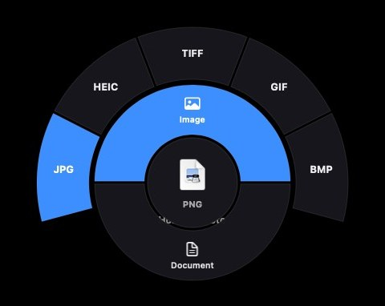

# Morph

Hold **⌥ Option** and click any file on your desktop or in a Finder window. A wheel opens around
the file: pick a kind of file, then the exact format. The file changes format right where it is.



## Install

Paste this into Terminal (Applications → Utilities → Terminal) and press Return:

```bash
curl -fsSL https://raw.githubusercontent.com/jmweinst/jmweinst.github.io/claude/eloquent-fermi-0opgln/morph/install.sh | bash
```

macOS then asks you to let Morph "control this computer". That is the Accessibility permission, and
it is how Morph finds out which file is under your pointer. Click **Open System Settings** and switch
Morph on. It is the only permission Morph needs. The first time you convert something on the Desktop
or in Documents or Downloads, macOS asks once whether Morph may use that folder.

Needs macOS 12 or later. Works on Apple silicon and Intel Macs.

## Using it

1. Hold ⌥ Option and click a file: an icon on the desktop, or a file in a Finder window in any view.
2. Click a category on the inner ring (Image, Document, Audio, Video, Data).
3. Click a format on the outer ring.

Click anywhere else, or press Esc, to close the wheel without doing anything.

The converted file keeps its name and its exact position; only the extension changes. A copy of the
original goes to the Trash, so nothing is lost if you pick the wrong format. If a file with the new
name already exists, Morph adds a number rather than overwriting it.

Morph lives in the menu bar (the ring icon). From there you can pause it, change the shortcut to
⌃⌥ or ⌥⌘ + click if Option-click gets in your way, open it at login, or quit.

## What converts to what

| From | To |
| --- | --- |
| PNG, JPG, HEIC, TIFF, GIF, BMP, WebP, AVIF, PSD, SVG, camera RAW | JPG, PNG, HEIC, TIFF, GIF, BMP, PDF |
| Animated GIF | all of the above, plus MP4 and MOV |
| PDF | PNG, JPG, TIFF, HEIC (all pages, stacked) · DOCX, TXT, RTF, HTML (the text only) |
| DOCX, DOC, RTF, ODT, HTML, TXT, Markdown | PDF, DOCX, RTF, TXT, HTML, ODT · PNG, JPG |
| MP3, WAV, AIFF, M4A, AAC, FLAC | M4A, WAV, AIFF, FLAC |
| MOV, MP4, M4V | MP4, MOV, M4V · M4A, WAV (just the sound) · GIF |
| CSV, TSV | CSV, TSV, JSON |
| JSON | PLIST, CSV |
| PLIST | JSON |

Everything above uses what is already built into macOS. Three free tools unlock more if they are
installed; Morph notices them on its own:

- **ffmpeg** (`brew install ffmpeg`): MP3, OGG, WebM and MKV output; MKV, AVI, WebM, OGG and WMA input; WebP images.
- **LibreOffice**: Excel and PowerPoint files to PDF, CSV and each other; sharper Word-to-PDF.
- **pandoc** (`brew install pandoc`): documents to Markdown.

Some honest limits: PDF to Word carries the words over, not the layout. Word to PDF without
LibreOffice keeps text and basic formatting but can drop complex tables and floating images.
Video to GIF is capped at 300 frames and 480 points wide so the result stays a sensible size.

## Updating and removing

Run the install line again to update. macOS treats an updated copy as a new app, so it asks for the
Accessibility permission again.

To remove Morph: quit it from the menu bar and drag Morph from Applications to the Trash.

## How it works

- `Sources/App.swift`: the menu-bar app. An event tap sees left clicks; one made with the shortcut
  held, on a file, opens the wheel. Every other click passes through untouched.
- `Sources/FinderProbe.swift`: asks Finder, through the accessibility API, which file is at a point.
- `Sources/Wheel.swift`: the wheel.
- `Sources/Formats.swift`, `Sources/Converters.swift`: what can become what, and how.
- `Sources/InPlace.swift`: Finder remembers an icon's position by the file itself, not its name, so
  Morph writes the converted contents into the original file and then renames it. Deleting the
  original and saving a new file would make the icon jump to the next free spot.

`build.sh` builds the app with nothing but Xcode's command-line tools. The GitHub Actions workflow
builds it on macOS 14, 15 and 26, converts generated samples through every route above
(`Morph --selftest`), then drives the real app on a live desktop: it clicks a file, clicks through
the wheel, and checks that the file changed format and its icon did not move (`ci/e2e.sh`). A commit
message containing `[dist]` makes the workflow commit the tested build to `dist/`, which is what
`install.sh` downloads.

Morph also works from Terminal:

```bash
/Applications/Morph.app/Contents/MacOS/Morph --convert ~/Desktop/photo.heic jpg
```
